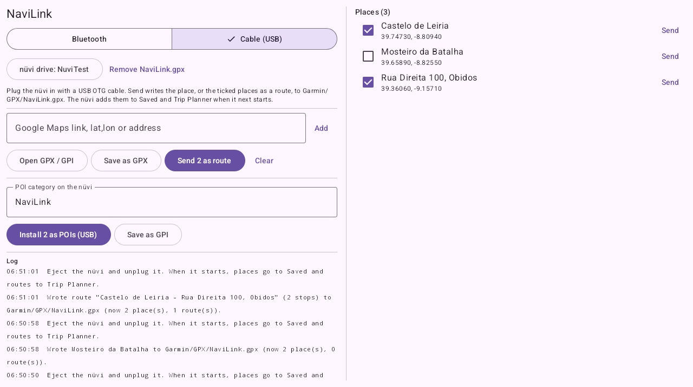

# NaviLink

Send places from Google Maps to a Garmin nüvi over Bluetooth or a USB cable, and put your own
POIs on it, without Garmin Smartphone Link. An Android app.

<p></p>

Built for the **nüvi 3490 on firmware 8.50**, including nüvi 3790/3760/3750 units converted to a 3490.
Other nüvis that work with Smartphone Link on Android probably speak the same protocol, but haven't been tried.

> **Status: early test version.** The POI files are checked byte for byte against gpsbabel.
> Sending over Bluetooth follows Smartphone Link's protocol exactly, and sending by cable writes the
> same kind of GPX file Garmin BaseCamp does, but **neither has been tried on a real nüvi yet**.
> If you try it, please [open an issue](https://github.com/skinnie/navilink/issues) with the app's log,
> whether it worked or not.

## Why

Smartphone Link is the only official way to send a place from a phone to these nüvis. It is fussy
about connecting, its map is server-side data from 2015, and it was never available on iPhone for
most models. NaviLink does the useful parts on its own:

| | Smartphone Link | NaviLink |
|---|---|---|
| Send a Google Maps place to the nüvi | from its own map or search | **share from Google Maps**, a link, coordinates or an address |
| How it reaches the nüvi | Bluetooth | **Bluetooth or USB cable** |
| Load your own POIs | — | **.gpi from GPX/GPI lists, installed over USB** |
| Get the nüvi's saved places back | kept inside the app | **save as GPX** |
| Live traffic, weather, Garmin services | yes | no |

## Get it

Download `NaviLink-android.apk` from the [Releases page](https://github.com/skinnie/navilink/releases)
and open it on your phone or tablet (Android 8 or newer). Allow "install unknown apps" for your
browser or file manager when Android asks.

## Send places over Bluetooth

Leave NaviLink on **Bluetooth** (the switch at the top).

1. Pair the nüvi with your phone in Android's Bluetooth settings, the same way as for hands-free calls.
2. **Force-stop Smartphone Link** if it's installed (*Settings → Apps → Smartphone Link → Force stop*).
   Both apps offer the same Bluetooth service, so only one can run at a time.
3. Add places to NaviLink:
   - In Google Maps, open a place and **Share → NaviLink**. Links from a browser or chat work too.
   - Or type in the box: a Google Maps link, `39.7436, -8.8071`, or an address.
   - Or **Open GPX / GPI** to load a list of places.
4. Pick the nüvi at the top, then **Send** next to a place. Tick several places and press
   **Send N as route** to send them as one route.

If the nüvi doesn't react, press **Listen (GarminLink)**, open Smartphone Link on the nüvi's screen
so it connects to the phone, then press **Send** again. **Ping** wakes the nüvi the way Smartphone
Link does. The log at the bottom shows every message exchanged with the nüvi.

### Places from the nüvi

While NaviLink is listening, anything the nüvi sends to the phone is added to the list: its
current destination, its parking spot and its saved places. **Save as GPX** keeps them, for example
as a backup of the nüvi's favourites.

## Send places by cable (USB)

For when Bluetooth won't connect, or to load a trip planned ahead.

1. Switch NaviLink to **Cable (USB)**.
2. Connect the nüvi to the phone or tablet with a USB OTG adapter and wait for Android to show it as a drive.
3. Press **Send** next to a place to add it to the nüvi's saved places, or tick several and press
   **Send N as route** for a trip. The first time, pick the nüvi's drive; NaviLink remembers it.
4. Eject the nüvi and unplug it. When it starts, the places are under **Saved** in *Where To?* and
   routes are in **Trip Planner**.

NaviLink writes everything it sends into one file, `Garmin/GPX/NaviLink.gpx` (Garmin BaseCamp does
the same with `temp.gpx`), and adds to it on each send. The nüvi may read the file again every time it
starts, so once the places are on the nüvi, press **Remove NaviLink.gpx**; otherwise a place you
delete on the nüvi can come back. The nüvi works out the roads between a route's stops itself.
Keep routes short until this has been tried: one nüvi 3590 owner saw a 22-stop BaseCamp route arrive
with 15 stops.

## Install POIs (USB)

The nüvi can't receive files over Bluetooth (its firmware has no command for it), so POIs go over USB.

1. Load the places: **Open GPX / GPI**, shared links, or places from the nüvi.
2. Type the **POI category** the nüvi should list them under (places from a `.gpi` keep their own categories).
3. Connect the nüvi to the phone or tablet with a USB OTG adapter and wait for Android to show it as a drive.
4. Press **Install as POIs (USB)**. The first time, pick the nüvi's drive (or its `Garmin` folder).
   NaviLink writes `Garmin/POI/<category>.gpi`, one file per category.
5. Eject the nüvi before unplugging it. The POIs are under **Custom POIs** in *Where To?*.

**Save as GPI** writes the same file anywhere instead, to copy to the nüvi from a computer.
Both buttons use the ticked places, or all places when none are ticked.

The `.gpi` files use the same layout as gpsbabel's (which loads on nüvis) and are text in
Windows-1252, so accents are fine; characters outside it (like emoji) become `?`.
POIs use the nüvi's default icon.

## What it understands

| Input | Example |
|---|---|
| Google Maps short link | `https://maps.app.goo.gl/…` |
| Google Maps place or directions link | `https://www.google.com/maps/place/Castelo+de+Leiria/@39.7473,-8.8094,17z` |
| `geo:` link | `geo:39.7436,-8.8071?q=39.7436,-8.8071(Leiria)` |
| Coordinates | `39.7436, -8.8071` or `39°44'37.0"N 8°48'25.6"W` |
| Address | `Largo do Papa Paulo VI, Leiria` (looked up on OpenStreetMap) |
| GPX | waypoints; or the route/track, thinned to 30 points |
| GPI | Garmin POI files (not the encrypted ones some paid add-ons use) |

## How it works

Smartphone Link and the nüvi talk over two Bluetooth serial links using small HTTP-style text
messages. The phone sends `POST /new-route` with one line per stop; the nüvi sends its own requests
(`/auth-info`, `/find-destination`, `/parking-spot`, `/save-locations`) to a "GarminLink" service on
the phone. NaviLink plays both sides.

By cable, NaviLink writes a GPX 1.1 file with Garmin's extensions (address, phone, category) into
`Garmin/GPX`, which the nüvi reads when it starts. Details, including what's in firmware 8.50:
[docs/PROTOCOL.md](docs/PROTOCOL.md).

## Build

Needs JDK 17 and the Android SDK (platform 36). `local.properties` must point at the SDK
(`sdk.dir=/path/to/android-sdk`).

```sh
./gradlew :app:desktopTest      # protocol and file tests (GPI tests also use gpsbabel if it's installed)
./gradlew :app:assembleDebug    # app/build/outputs/apk/debug/app-debug.apk
```

Kotlin and Compose. The protocol and file code is in `app/src/jvmSharedMain` and is tested on the
desktop JVM; the Android screens and Bluetooth are in `app/src/androidMain`.

| File | What |
|---|---|
| `nuvi/Protocol.kt` | message framing, `/new-route`, answers to the nüvi's requests |
| `nuvi/GpiWriter.kt` | `.gpi` writer |
| `nuvi/Files.kt` | GPX/GPI import, GPX export |
| `nuvi/CableGpx.kt` | the GPX file for sending by cable |
| `core/` | Google Maps link parsing, GPX and GPI reading (shared with [MapsToTom](https://github.com/skinnie/MapsToTom/tree/kotlin-app/composeApp/src/jvmSharedMain/kotlin/app/mapstotom/core)) |
| `BtLink.kt` | the two Bluetooth links |
| `UsbDrive.kt` | the nüvi's drive: POI files and the cable GPX file |

## Related

- [MapsToTom](https://github.com/skinnie/MapsToTom/tree/kotlin-app): the same idea for old TomTom navigators.
- [MapsReceiver](https://github.com/shaun-plumb/MapsReceiver): passes Google Maps shares on to Smartphone Link.
- [GPSBabel](https://www.gpsbabel.org): converts between GPS file formats, including `.gpi`.

## Licence

MIT, see [LICENSE](LICENSE).

Not affiliated with or endorsed by Garmin. Garmin, nüvi and Smartphone Link are trademarks of
Garmin Ltd. or its subsidiaries. The protocol notes come from studying Smartphone Link and the nüvi
firmware so that other software can work with the nüvi.
