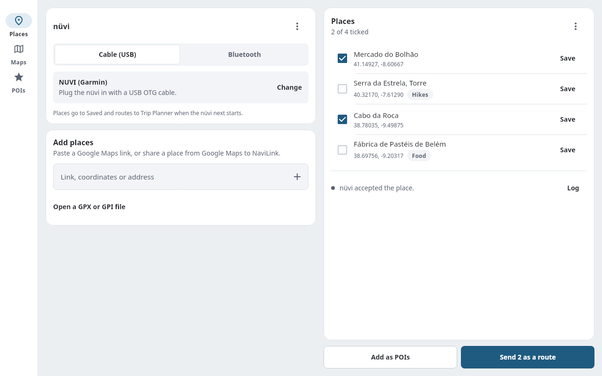

# NaviLink

Send places from Google Maps to a Garmin nüvi over a USB cable (or Bluetooth, still untested), and put your own
POIs and OpenStreetMap maps on it, without Garmin Smartphone Link. An Android app, with a desktop
version for building maps.

<p></p>

Built for the **nüvi 3490 on firmware 8.50**, including nüvi 3790/3760/3750 units converted to a 3490.
Other nüvis that work with Smartphone Link on Android probably speak the same protocol, but haven't been tried.

> **Status: early test version, not yet tried on a real nüvi.** The owner is away from his devices
> for now, so everything has only been tested against fake nüvi folders and file-format checks:
> the POI files are checked byte for byte against gpsbabel, Bluetooth follows Smartphone Link's
> protocol exactly, the cable writes the same kind of GPX file Garmin BaseCamp does, and maps are
> installed as standard `gmapsupp.img` files. **Feedback is appreciated:** if you try it, please
> [open an issue](https://github.com/skinnie/navilink/issues) with the app's log, whether it worked or not.

## Why

Smartphone Link is the only official way to send a place from a phone to these nüvis. It is fussy
about connecting, its map is server-side data from 2015, and it was never available on iPhone for
most models. NaviLink does the useful parts on its own:

| | Smartphone Link | NaviLink |
|---|---|---|
| Send a Google Maps place to the nüvi | from its own map or search | **share from Google Maps**, a link, coordinates or an address |
| How it reaches the nüvi | Bluetooth | **USB cable**, or Bluetooth (not yet tried on a real nüvi) |
| Load your own POIs | — | **.gpi from GPX/GPI lists, installed over USB** |
| Ready-made POI packs | — | **fuel, LPG, campsites, water… from OpenStreetMap and Foursquare, without doubling what's already on the Garmin** |
| Get the nüvi's saved places back | kept inside the app | **save as GPX** |
| Live traffic, weather, Garmin services | yes | **yes, relayed to Garmin like Smartphone Link** (not yet tried on a real nüvi); weather can also come from Open-Meteo |
| Stays connected with the screen off | often drops | **background service: reconnects and wakes the nüvi when it comes into range** |

## Get it

From the [Releases page](https://github.com/skinnie/navilink/releases):

| | Download | Install |
|---|---|---|
| Android 8 or newer | `NaviLink-android.apk` | Open it on the phone or tablet; allow "install unknown apps" for your browser or file manager when Android asks. |
| Linux (Ubuntu 22.04+, Mint 21+, Debian 12) | `NaviLink-linux.deb` | `sudo apt install ./NaviLink-linux.deb`, then NaviLink is in the menu under Accessories/Utilities. |
| Windows 10/11 | `NaviLink-windows.msi` | Run it; it installs for your user only, no administrator needed. The installer isn't code-signed, so SmartScreen asks once ("More info", "Run anyway"). |
| macOS | `NaviLink-macos.dmg` | Drag NaviLink to Applications. It isn't notarised: the first time, right-click it and choose Open. |

Each new version installs over the old one. The version number is the same everywhere, except that Windows
and macOS show 0.x as 1.x (their installers don't accept a 0).

## On the device (Device tab)

Like JaVaWa Device Manager, for any Garmin that shows up as a drive: what maps are on it and on its card, what
is wrong with them (the same map twice, maps the model skips, damaged or locked files, too many maps), where each
map covers, renaming maps and map sets inside the files, moving them between the built-in memory and the card,
removing them with a copy kept, putting files of any kind into the folder the device reads them from, backup and
restore, the startup message, and software from Garmin (device software, voices, vehicles, languages, the time-zone
map) as Garmin's WebUpdater offered it. Licensed map updates and safety cameras stay with Garmin Express.

## Send places by cable (USB)

The default way, and the one to use until Bluetooth has been tried on a real nüvi.

1. Leave NaviLink on **Cable (USB)** (the switch at the top).
2. Connect the nüvi to the phone or tablet with a USB OTG adapter and wait for Android to show it as a drive.
3. Press **Send** next to a place to add it to the nüvi's saved places, or tick several and press
   **Send N as route** for a trip. The first time, pick the nüvi's drive; NaviLink remembers it.
4. Eject the nüvi and unplug it. When it starts, the places are under **Saved** in *Where To?* and
   routes are in **Trip Planner**.

NaviLink writes everything it sends into one file, `Garmin/GPX/NaviLink.gpx` (Garmin BaseCamp does
the same with `temp.gpx`), and adds to it on each send. The nüvi may read the file again every time it
starts, so once the places are on the nüvi, press **Remove NaviLink.gpx**; otherwise a place you
delete on the nüvi can come back. The nüvi works out the roads between a route's stops itself.
Keep routes short until this has been tried: one nüvi 3590 owner saw a 22-stop BaseCamp route arrive
with 15 stops.

## Send places over Bluetooth (untested)

> **Not yet tried on a real nüvi.** The Bluetooth side follows Smartphone Link's protocol, but no
> nüvi has answered NaviLink yet. If it doesn't connect, use the
> cable, and please [open an issue](https://github.com/skinnie/navilink/issues) with the log.

Switch NaviLink to **Bluetooth** (the switch at the top).

1. Pair the nüvi with your phone in Android's Bluetooth settings, the same way as for hands-free calls.
2. **Force-stop Smartphone Link** if it's installed (*Settings → Apps → Smartphone Link → Force stop*).
   Both apps offer the same Bluetooth service, so only one can run at a time.
3. Add places to NaviLink:
   - In Google Maps, open a place and **Share → NaviLink**. Links from a browser or chat work too.
   - Or type in the box: a Google Maps link, `39.7436, -8.8071`, or an address.
   - Or **Open GPX / GPI** to load a list of places.
4. Pick the nüvi at the top, then **Send** next to a place. Tick several places and press
   **Send N as route** to send them as one route.

If the nüvi doesn't react, press **Listen (GarminLink)**, open Smartphone Link on the nüvi's screen
so it connects to the phone, then press **Send** again. **Ping** wakes the nüvi the way Smartphone
Link does. The log at the bottom shows every message exchanged with the nüvi.

### Live Services (traffic, accidents, weather)

> **Not yet tried on a real nüvi.** The relay itself has been checked against Garmin's server:
> a registration and a Lisbon traffic request went through it and came back intact.

Turn on **Live Services** in the Bluetooth card. NaviLink then runs in the background (a
notification shows the state) and does what Smartphone Link does for Live Services:

- It answers the nüvi's `/auth-info` with a phone identity. The nüvi signs its own Live Services
  requests with it, and no Garmin or Google account is needed.
- It relays every request the nüvi addresses to the internet (to `gold.garmin.com`, over TLS) and
  passes Garmin's answer back unchanged. That covers traffic and accidents, and also whatever else
  Garmin still serves for free.
- It keeps offering the link, and when the nüvi comes into Bluetooth range it pings it so it
  connects. Turning Bluetooth off and on is handled too.
- **Weather** can come from Garmin, from Open-Meteo when Garmin refuses or can't be reached (the
  default), or from Open-Meteo only. Open-Meteo is free and needs no key.

Close Smartphone Link first: both apps offer the same Bluetooth service. Every exchange is kept in
capture files on the phone (*⋮ → Share link captures*). They hold the nüvi's unit ID and session
keys, so share them only with people you trust.

### Places from the nüvi

While NaviLink is listening, anything the nüvi sends to the phone is added to the list: its
current destination, its parking spot and its saved places. **Save as GPX** keeps them, for example
as a backup of the nüvi's favourites.

## Install POIs (USB)

The nüvi can't receive files over Bluetooth (its firmware has no command for it), so POIs go over USB.

1. Load the places: **Open GPX / GPI**, shared links, or places from the nüvi.
2. Type the **POI category** the nüvi should list them under (places from a `.gpi` keep their own categories).
3. Connect the nüvi to the phone or tablet with a USB OTG adapter and wait for Android to show it as a drive.
4. Press **Install as POIs (USB)**. The first time, pick the nüvi's drive (or its `Garmin` folder).
   NaviLink writes `Garmin/POI/<category>.gpi`, one file per category.
5. Eject the nüvi before unplugging it. The POIs are under **Custom POIs** in *Where To?*.

**Save as GPI** writes the same file anywhere instead, to copy to the nüvi from a computer.
Both buttons use the ticked places, or all places when none are ticked.

The `.gpi` files use the same layout as gpsbabel's (which loads on nüvis) and are text in
Windows-1252, so accents are fine; characters outside it (like emoji) become `?`.
POIs use the nüvi's default icon.

## POI packs (POIs page)

Ready-made POIs for whole countries: fuel stations, LPG, EV chargers, motorhome areas, campsites,
drinking water, toilets and more from **OpenStreetMap** (© OpenStreetMap contributors, ODbL), and
restaurants, cafés, hotels, museums and more from **Foursquare Open Source Places** (Apache-2.0).
Each kind becomes one file, `Garmin/POI/OSM Fuel.gpi` and so on, under **Custom POIs** on the Garmin.
On a phone, pick the Garmin's drive as for maps; on a PC, the device chosen at the top is used.

Before writing, NaviLink looks at what's already on the Garmin and its memory card, by what's in the
files rather than their names (those change with every release):

- **POI files** (`.gpi`), such as iOverlander's or your own: a new place within 150 m of a place of
  the same kind already there is left out (a new fuel station is checked against fuel stations, not
  against the water tap next door). iOverlander is recognised by its name, copyright and Garmin part
  number. NaviLink's own files from an earlier run are replaced, not counted.
- **Map add-ons** (`.img`) that hold POIs, such as City Navigator's Foursquare layer: their places
  can't be read one by one, so the whole source is left out (no Foursquare places when the
  Foursquare add-on is there), unless you choose **Add Foursquare anyway**.

Kinds from one source don't knock each other out (a campsite next to a motorhome area stays), but
Foursquare places are checked against the OpenStreetMap ones of the same kind. Speed cameras can't
be chosen for France, where warning of their positions is illegal.

## What it understands

| Input | Example |
|---|---|
| Google Maps short link | `https://maps.app.goo.gl/…` |
| Google Maps place or directions link | `https://www.google.com/maps/place/Castelo+de+Leiria/@39.7473,-8.8094,17z` |
| `geo:` link | `geo:39.7436,-8.8071?q=39.7436,-8.8071(Leiria)` |
| Coordinates | `39.7436, -8.8071` or `39°44'37.0"N 8°48'25.6"W` |
| Address | `Largo do Papa Paulo VI, Leiria` (looked up on OpenStreetMap) |
| GPX | waypoints; or the route/track, thinned to 30 points |
| GPI | Garmin POI files (not the encrypted ones some paid add-ons use) |

## How it works

Smartphone Link and the nüvi talk over two Bluetooth serial links using small HTTP-style text
messages. The phone sends `POST /new-route` with one line per stop; the nüvi sends its own requests
(`/auth-info`, `/find-destination`, `/parking-spot`, `/save-locations`) to a "GarminLink" service on
the phone. NaviLink plays both sides.

For Live Services, Smartphone Link is a plain HTTP relay. A request from the nüvi whose `Host` isn't
`device` is sent unchanged to that host (port 443 over TLS for `*.garmin.com`), and the raw answer
goes back. The nüvi builds Garmin's protobuf ("OBN") requests itself, using the identity from
`/auth-info`. NaviLink reads the protobuf only to log which service was asked for and to answer
weather from Open-Meteo, in Garmin's own `WeatherResponse` layout (rebuilt from Smartphone Link's
message classes).

By cable, NaviLink writes a GPX 1.1 file with Garmin's extensions (address, phone, category) into
`Garmin/GPX`, which the nüvi reads when it starts. Details, including what's in firmware 8.50:
[docs/PROTOCOL.md](docs/PROTOCOL.md).

## Build

Needs JDK 17 and the Android SDK (platform 36). `local.properties` must point at the SDK
(`sdk.dir=/path/to/android-sdk`).

```sh
./gradlew :app:desktopTest      # protocol and file tests (GPI tests also use gpsbabel if it's installed)
NAVILINK_NET=1 ./gradlew :app:desktopTest --tests app.navilink.LiveNetTest   # relay + weather against the real servers
./gradlew :app:assembleDebug    # app/build/outputs/apk/debug/app-debug.apk
./gradlew :app:run              # the desktop app
./gradlew :app:packageDeb       # Linux installer (packageMsi on Windows, packageDmg on macOS)
```

The version lives in `gradle.properties` (`navilink.version`, `navilink.versionCode`). The icons are drawn by
`tools/make-icons.py` (needs Pillow), which writes every size the installers and Android use.

Kotlin and Compose. The protocol and file code is in `app/src/jvmSharedMain` and is tested on the
desktop JVM; the Android screens and Bluetooth are in `app/src/androidMain`.

| File | What |
|---|---|
| `nuvi/Protocol.kt` | message framing, `/new-route`, answers to the nüvi's requests |
| `nuvi/GpiWriter.kt` | `.gpi` writer |
| `nuvi/Files.kt` | GPX/GPI import, GPX export |
| `nuvi/CableGpx.kt` | the GPX file for sending by cable |
| `pois/` | POI packs: OpenStreetMap and Foursquare sources, recognising POI sets already on the Garmin, leaving out what's there |
| `core/` | Google Maps link parsing, GPX, GPI and Parquet reading (shared with [MapsToTom](https://github.com/skinnie/MapsToTom/tree/kotlin-app/composeApp/src/jvmSharedMain/kotlin/app/mapstotom/core)) |
| `live/` | Live Services: relay (`Relay.kt`, `LiveRouter.kt`), phone identity (`Identity.kt`), protobuf (`Pb.kt`, `Obn.kt`), Open-Meteo weather (`Weather.kt`), capture files |
| `BtLink.kt` | the two Bluetooth links |
| `LinkService.kt`, `Live.kt` | background service: keeps GarminLink offered, wakes the nüvi, notification |
| `UsbDrive.kt` | the nüvi's drive: POI files and the cable GPX file |
| `device/` | the Device tab (shared by desktop and Android); its file work is in `osmimg/` (`DeviceContents.kt`, `ImgEdit.kt`, `DeviceFiles.kt`, `GarminUpdates.kt`, `StartupText.kt`) |

## Related

- [MapsToTom](https://github.com/skinnie/MapsToTom/tree/kotlin-app): the same idea for old TomTom navigators.
- [MapsReceiver](https://github.com/shaun-plumb/MapsReceiver): passes Google Maps shares on to Smartphone Link.
- [GPSBabel](https://www.gpsbabel.org): converts between GPS file formats, including `.gpi`.

## Licence

MIT, see [LICENSE](LICENSE).

Not affiliated with or endorsed by Garmin. Garmin, nüvi and Smartphone Link are trademarks of
Garmin Ltd. or its subsidiaries. The protocol notes come from studying Smartphone Link and the nüvi
firmware so that other software can work with the nüvi.
